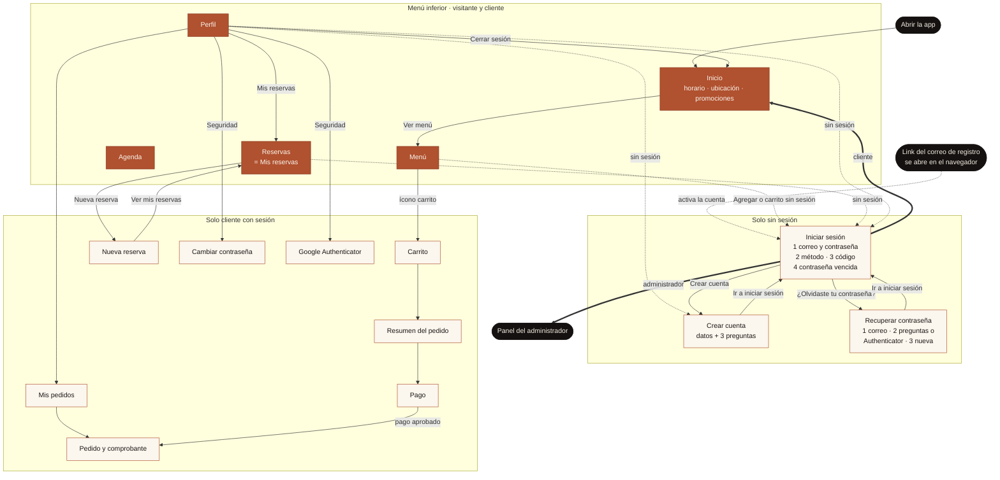
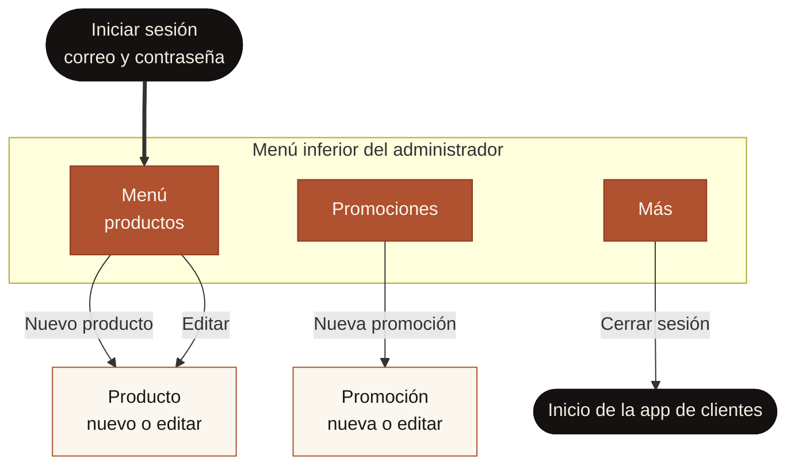

# AL FORNO · App móvil

Proyecto universitario: app móvil para la pizzería AL FORNO.
Historias de usuario vigentes: versión 2.7 (`Doc/`, fuera de git).

## Estructura

```
al_forno/
 ├─ app/        App móvil (React Native + Expo)
 │   └─ src/
 │       ├─ app/          Pantallas (cada archivo es una pantalla; Expo Router)
 │       ├─ components/   Piezas reutilizables (botones, campos, avisos, secciones)
 │       ├─ context/      Datos compartidos entre pantallas: sesión y carrito
 │       ├─ services/     Llamadas a la API (api.js es el único que usa fetch)
 │       ├─ utils/        Funciones de apoyo (colones, carrito, política de contraseñas)
 │       └─ config/       Dirección de la API y colores
 ├─ api/        API REST (Node.js + Express)
 │   └─ src/
 │       ├─ modulos/      Un módulo por carpeta, con sus 3 capas:
 │       │    └─ menu/      menu.rutas.js → menu.servicio.js → menu.repositorio.js → MySQL
 │       ├─ config/       Conexión a MySQL (db.js), datos fijos del restaurante
 │       │                (restaurante.js, agenda.js) y reglas de seguridad (seguridad.js)
 │       ├─ middlewares/  Sesión y roles (autenticacion.js), validación (validar.js,
 │       │                reglasCuenta.js) y manejo central de errores (errores.js)
 │       └─ utils/        Hora de Costa Rica, cifrado AES, envío de correos y errorCon
 │                        (errores.js: crea los errores con su código HTTP)
 └─ database/   Scripts SQL (tablas, procedimientos, datos iniciales)
```

## Arquitectura en 5 capas

```
1. App (pantalla) ─→ services/api.js ─[internet]─→ 2. API (<modulo>.rutas.js)
   ─→ 3. Lógica de negocio (<modulo>.servicio.js) ─→ 4. Acceso a datos (<modulo>.repositorio.js)
   ─→ 5. MySQL (procedimiento almacenado: CALL sp_...)
```

Todas las funciones siguen este mismo camino. Para ver cómo funciona un módulo,
basta abrir su carpeta en `api/src/modulos/`. Los módulos `recuperacion` y
`perfil` no tienen repositorio propio: usan `auth/auth.repositorio.js`.

## Seguridad de la cuenta (solo clientes)

| Qué | Cómo | Historia |
|---|---|---|
| Registro | Datos + 3 preguntas de seguridad. La cuenta queda `PENDIENTE` hasta abrir el link del correo (vence en 24 h, un solo uso) | HU-01 |
| Inicio de sesión | Correo y contraseña → código de 6 dígitos por correo (vence en 2 min) o de Google Authenticator | HU-02, HU-21 |
| Bloqueo | 3 intentos fallidos seguidos → bloqueada 1 minuto (cuentan contraseña, códigos y respuestas) | HU-02 |
| Política de contraseñas | 8 caracteres o más con mayúscula, minúscula, número y símbolo; vence a los 90 días; no se repiten las últimas 5. La app muestra la lista con ✓ y la API la vuelve a revisar | HU-20 |
| Recuperar contraseña | Correo → 3 preguntas o código de Google Authenticator → contraseña nueva. Se avisa por correo | HU-22 |
| Google Authenticator | Opcional, desde el Perfil. Se vincula copiando la clave (sin QR) y confirmando el primer código | HU-21 |
| Datos sensibles | Contraseñas y respuestas con bcrypt; cédula, teléfono y clave de Authenticator cifrados con AES-256-GCM; códigos con hash SHA-256; la sesión de la app solo vive en memoria | HU-23 |
| Auditoría | Tabla `auditoria`: registro, logins exitosos y fallidos, bloqueos, cambios y recuperaciones de contraseña. Se consulta en la base (ver "Consultar la bitácora") | HU-24 |

Entre un paso y otro del login y de la recuperación, la API entrega un **pase**:
un token temporal (10 minutos) que solo sirve para el paso siguiente.
El administrador entra con correo y contraseña, sin doble factor (HU-14).

## Base de datos (11 tablas, 35 procedimientos)

| Tabla | Para qué |
|---|---|
| `usuario` | Clientes y administrador: datos (cédula y teléfono cifrados, `cedula_hash` para no repetir la cédula), contraseña bcrypt, estado, intentos y bloqueo, Google Authenticator |
| `producto` | Menú (HU-03) |
| `promocion` | Promociones informativas (HU-06) |
| `pedido`, `pedido_detalle` | Pedidos pagados y sus productos (HU-07 a HU-09) |
| `reserva` | Reservas: fecha, hora, personas, estado (HU-10, HU-11) |
| `pregunta_seguridad` | Las 5 preguntas para elegir (HU-01) |
| `usuario_respuesta` | Las 3 respuestas de cada cliente, con bcrypt (HU-01, HU-22) |
| `contrasena_historial` | Las últimas contraseñas, para no repetirlas (HU-20) |
| `token` | Link de verificación y código del doble factor: hash, vence, un solo uso (HU-01, HU-21) |
| `auditoria` | Actividad de seguridad, con fecha y hora de Costa Rica (HU-24) |

El horario, los datos del restaurante y la agenda no están en la base: son fijos
en `api/src/config/restaurante.js` y `api/src/config/agenda.js`.

## Cómo se conecta cada pantalla

| Pantalla (`app/src/app/`) | Servicio de la app | Endpoint | Módulo | Procedimiento / origen |
|---|---|---|---|---|
| Inicio · Horario — `(tabs)/index.js` | `obtenerHorario()` | `GET /api/horario` | informacion | Fijo en `config/restaurante.js` |
| Inicio · Ubicación — `(tabs)/index.js` | `obtenerRestaurante()` | `GET /api/restaurante` | informacion | Fijo en `config/restaurante.js` |
| Inicio · Promociones — `(tabs)/index.js` | `listarPromociones()` | `GET /api/promociones` | informacion | `sp_ListarPromocionesActivas` |
| Menú — `(tabs)/menu.js` | `obtenerMenu()` | `GET /api/menu` | menu | `sp_ListarMenu` |
| Agenda — `(tabs)/agenda.js` | `listarAgenda()` | `GET /api/agenda` | agenda | Fija en `config/agenda.js` |
| Carrito y Resumen — `carrito.js`, `resumen-pedido.js` | — | — | — | Solo en la app (`context/CarritoContext.js`) |
| Pago — `pago.js` | `crearPedido()` | `POST /api/pedidos` | pedidos | `sp_CrearPedido` |
| Mis pedidos — `mis-pedidos/index.js` | `listarMisPedidos()` | `GET /api/pedidos` | pedidos | `sp_ListarPedidosCliente` |
| Pedido y comprobante — `mis-pedidos/[id].js` | `obtenerPedido()` | `GET /api/pedidos/:id` | pedidos | `sp_ObtenerPedido` (el estado lo calcula la API) |
| Nueva reserva — `nueva-reserva.js` | `listarHoras()`, `crearReserva()` | `GET /api/reservas/horas`, `POST /api/reservas` | reservas | `sp_ListarOcupacion`, `sp_CrearReserva` |
| Mis reservas — `(tabs)/reservas.js` | `listarMisReservas()`, `cancelarReserva()` | `GET /api/reservas`, `PATCH /api/reservas/:id/cancelar` | reservas | `sp_ListarReservasCliente`, `sp_CancelarReserva` |
| Crear cuenta — `registro.js` | `obtenerPreguntas()`, `registrar()`, `reenviarVerificacion()` | `GET /api/auth/preguntas`, `POST /api/auth/registro`, `POST /api/auth/reenviar-verificacion` | auth | `sp_ListarPreguntas`, `sp_RegistrarUsuario`, `sp_GuardarToken`, `sp_ObtenerUsuarioPorCorreo`, `sp_RegistrarAuditoria` |
| Link del correo (navegador) | — | `GET /api/auth/verificar?token=` | auth | `sp_UsarToken`, `sp_ActivarUsuario` |
| Iniciar sesión — `login.js` | `login()`, `enviarCodigo()`, `verificarCodigo()`, `cambiarContrasenaVencida()` | `POST /api/auth/login`, `/login/enviar-codigo`, `/login/verificar`, `/login/cambiar-contrasena` | auth | `sp_ObtenerUsuarioPorCorreo`, `sp_ActualizarIntentos`, `sp_GuardarToken`, `sp_UsarToken`, `sp_ObtenerAuthenticator`, `sp_CambiarContrasena`, `sp_ListarHistorialContrasenas`, `sp_RegistrarAuditoria` |
| Recuperar contraseña — `recuperar.js` | `iniciarRecuperacion()`, `verificarIdentidad()`, `guardarNuevaContrasena()` | `POST /api/recuperacion/inicio`, `/verificar`, `/nueva` | recuperacion | `sp_ObtenerUsuarioPorCorreo`, `sp_ObtenerPreguntasUsuario`, `sp_ObtenerAuthenticator`, `sp_ActualizarIntentos`, `sp_CambiarContrasena`, `sp_ListarHistorialContrasenas`, `sp_RegistrarAuditoria` |
| Perfil — `(tabs)/perfil.js` | `obtenerPerfil()` | `GET /api/perfil` | perfil | `sp_ObtenerUsuario` |
| Cambiar contraseña — `cambiar-contrasena.js` | `cambiarContrasena()` | `PUT /api/perfil/contrasena` | perfil | `sp_ObtenerUsuarioPorCorreo`, `sp_CambiarContrasena`, `sp_ListarHistorialContrasenas`, `sp_RegistrarAuditoria` |
| Google Authenticator — `autenticador.js` | `iniciarVinculacion()`, `confirmarVinculacion()`, `desvincularAutenticador()` | `POST /api/perfil/autenticador`, `POST /api/perfil/autenticador/confirmar`, `DELETE /api/perfil/autenticador` | perfil | `sp_GuardarAuthenticator`, `sp_ObtenerAuthenticator`, `sp_ActivarAuthenticator`, `sp_DesvincularAuthenticator` |
| (Prueba de conexión) | — | `GET /api/salud` | salud | `SELECT 1` |

Las rutas `/api/auth` y `/api/recuperacion` aceptan como máximo 50 envíos (POST)
cada 15 minutos por dirección IP.

**Administrador (en pausa):** las pantallas `admin/` son plantillas
(`PantallaPendiente`). Los procedimientos ya existen en la base, pero todavía
no tienen ruta en la API:

| Pantalla | Procedimientos |
|---|---|
| Admin · Menú y Producto (HU-15) | `sp_ListarMenu`, `sp_ObtenerProducto`, `sp_CrearProducto`, `sp_EditarProducto`, `sp_EliminarProducto` |
| Admin · Promociones (HU-17) | `sp_ListarPromociones`, `sp_ObtenerPromocion`, `sp_CrearPromocion`, `sp_EditarPromocion`, `sp_CambiarEstadoPromocion` |

## Cómo correr el proyecto

1. **Base de datos:** ejecutar en MySQL Workbench, en orden, los scripts de `database/`
   (`01_tablas.sql`, `02_procedimientos.sql`, `03_datos_iniciales.sql`).
2. **API:**
   ```
   cd api
   npm install
   copy .env.example .env
   npm run dev
   ```
   En `.env` van los datos de MySQL y las llaves de seguridad (ver los
   comentarios de `.env.example`):
   - `CLAVE_CIFRADO` y `CLAVE_HASH_CEDULA`: se generan una sola vez con
     `node -e "console.log(require('crypto').randomBytes(32).toString('hex'))"`.
     Si se cambia `CLAVE_CIFRADO`, ya no se pueden leer las cédulas ni los teléfonos guardados.
   - `CORREO_USUARIO` y `CORREO_CONTRASENA`: cuenta de Gmail con contraseña de aplicación.
     **Si `CORREO_CONTRASENA` queda vacía, la API está en modo prueba:** no envía
     correos y muestra el link de verificación y los códigos en su terminal.
   - `URL_PUBLICA`: dirección que va en el link del correo. Con `http://localhost:3000`
     el link se abre en el navegador de la computadora; para abrirlo en el celular,
     poner la IP de la computadora (ej. `http://192.168.1.25:3000`). Ver "Antes de la defensa".

   El archivo `.env` nunca se sube a git. Probar en el navegador: http://localhost:3000/api/salud
3. **App:**
   ```
   cd app
   npm install
   npx expo start --clear
   ```
   Presionar `a` para abrir la app en el emulador de Android, o escanear el QR
   con Expo Go.

   **En el emulador de Android usar `npm run emulador`** (desde `app/`) y
   presionar `a`. Arranca Expo con la dirección `10.0.2.2`, que es como el
   emulador llama a la computadora. Con `npx expo start` normal, Expo le dice
   al emulador que descargue la app desde la IP de la red (ej. `192.168.0.10`)
   y a veces el emulador no la alcanza: Expo Go muestra "Something went wrong"
   y en "View error log" sale `Failed to download remote update`.
   En el celular real se sigue usando `npx expo start`.

   Si Expo Go dice que el proyecto es incompatible ("SDK 58"), Expo Go se
   actualizó solo. Desinstalarlo del emulador y presionar `a` otra vez: Expo
   instala la versión que corresponde al proyecto (SDK 57). En PowerShell:
   ```
   & "$env:LOCALAPPDATA\Android\Sdk\platform-tools\adb.exe" uninstall host.exp.exponent
   ```

   Para instalar librerías nuevas en la app usar `npx expo install <librería>`
   (no `npm install`), así quedan en versiones compatibles con Expo.

   Si un cambio no se ve en la app (sobre todo en `_layout.js` o en los
   contextos), reiniciar con `npx expo start --clear`.

4. **En un celular (Expo Go):** celular y computadora en la misma Wi-Fi, y
   escanear el QR. La app detecta sola la dirección de la API
   (`app/src/config/config.js`). No usar `--tunnel`. La primera vez, Windows
   puede pedir permiso para que Node.js use la red: hay que permitirlo.

5. **Google Authenticator:** se instala en el celular desde la tienda de apps.
   En Perfil → Google Authenticator → Generar clave → Copiar; en Google
   Authenticator tocar "+" → "Ingresar una clave de configuración", pegar la
   clave (basada en el tiempo) y escribir en AL FORNO el código que aparece.

**Usuario administrador** (creado por `03_datos_iniciales.sql`):
`admin@alforno.cr` / `Cambiar.AlForno2026`.

## Antes de la defensa

1. **Red:** conectar la computadora y el celular al **hotspot del celular**. La red de
   la U puede aislar los dispositivos entre sí o bloquear el envío de correos.
2. **IP de la computadora:** en la terminal, `ipconfig` → "Dirección IPv4" del
   adaptador Wi-Fi. Ponerla en `api/.env`: `URL_PUBLICA=http://<IP>:3000`.
3. **Reiniciar la API** (`Ctrl+C` y `npm run dev`): `--watch` no vuelve a leer el `.env`.
4. **MySQL encendido** y probar desde el navegador del celular `http://<IP>:3000/api/salud`.
5. **AVG:** Protección básica → Escudo de correo → "Analizar correos salientes (SMTP)"
   debe estar **desmarcado** (si no, falla el correo con `SELF_SIGNED_CERT_IN_CHAIN`).
   Para revisarlo, en `api/` (debe decir *Google Trust Services*):
   ```
   node -e "const t=require('tls').connect(465,'smtp.gmail.com',{rejectUnauthorized:false},()=>{let c=t.getPeerCertificate(true);while(c){console.log(c.issuer.O||c.issuer.CN);if(c.issuerCertificate===c)break;c=c.issuerCertificate}t.end()})"
   ```
6. **Prueba de correo:** crear una cuenta y revisar que llegan el link de
   verificación y el código de 6 dígitos. Para varias cuentas con un mismo Gmail se
   usa un alias (`tucorreo+prueba1@gmail.com`, `+prueba2`…) y una cédula distinta en cada una.
7. **App:** `npx expo start --clear` y escanear el QR con Expo Go.
   En el emulador: `npm run emulador` y presionar `a`.

Si no hay celular a mano para Google Authenticator, el código se genera en `api/` con
`node -e "console.log(require('otplib').generateSync({ secret: 'CLAVE' }))"`.

## Consultar la bitácora (tabla `auditoria`, HU-24)

En MySQL Workbench (primero `USE al_forno;` o doble clic en el schema):

```sql
-- Últimas 50 actividades
SELECT id, fecha, hora, correo, actividad, resultado, ip, dispositivo
FROM auditoria ORDER BY id DESC LIMIT 50;

-- Solo lo de hoy
SELECT fecha, hora, correo, actividad, resultado
FROM auditoria WHERE fecha = CURRENT_DATE ORDER BY hora DESC;

-- Intentos fallidos y bloqueos
SELECT fecha, hora, correo, actividad, ip
FROM auditoria WHERE actividad IN ('LOGIN_FALLIDO', 'BLOQUEO') ORDER BY id DESC;

-- Todo lo de un cliente
SELECT fecha, hora, actividad, resultado, ip
FROM auditoria WHERE correo = 'cliente@correo.com' ORDER BY id DESC;

-- Resumen: cuántas veces pasó cada actividad
SELECT actividad, resultado, COUNT(*) AS veces
FROM auditoria GROUP BY actividad, resultado ORDER BY actividad, resultado;
```

Actividades posibles: `REGISTRO`, `LOGIN_EXITOSO`, `LOGIN_FALLIDO`, `BLOQUEO`,
`CAMBIO_CONTRASENA`, `RECUPERACION`; resultado: `EXITO` o `FALLO`. `usuario_id` queda
en `NULL` cuando se escribió un correo que no existe.

## Mapa de navegación

GitHub dibuja estos diagramas. Las mismas imágenes están en `Doc/` (fuera de git):
`Mapa_navegacion_cliente.png` y `Mapa_navegacion_admin.png`.

Colores: **terracota** = pestañas del menú inferior; **crema** = pantallas que se abren
encima; **negro** = entradas y salidas. Línea punteada = pasa solo si no hay sesión;
línea gruesa = a dónde lleva la app sola después de iniciar sesión.

### Visitante y cliente



### Administrador (pantallas en pausa: plantillas)



Notas del mapa:

- **Quién ve qué** lo decide `app/src/app/_layout.js` con `Stack.Protected`: el visitante
  y el cliente ven el menú inferior; Iniciar sesión, Crear cuenta y Recuperar solo
  aparecen sin sesión; carrito, pago, pedidos, nueva reserva y Seguridad piden sesión de
  cliente; el panel `/admin` es solo del administrador, que no ve la app de clientes.
- **Nadie navega "a mano" después del login ni al cerrar sesión:** al cambiar la sesión,
  Expo Router lleva a la primera pantalla permitida (Inicio para el cliente, el panel
  para el administrador).
- **Botones que piden sesión** (Agregar en el Menú, ícono del carrito): sin sesión abren
  Iniciar sesión (`components/Boton.js`, `BotonCarrito.js`, `TarjetaProducto.js`).
- **Pago aprobado:** cierra Carrito, Resumen y Pago (`dismissAll`) y abre el comprobante;
  la flecha "atrás" ya no vuelve al pago.
- **Iniciar sesión y Recuperar contraseña** son una sola pantalla cada una, con pasos.
  El administrador termina en el paso 1 (sin doble factor).
- **Perfil y Reservas** tienen dos versiones: sin sesión invitan a iniciar sesión o
  crear cuenta; con sesión muestran los datos del cliente.
- La seguridad real no está en la navegación: la API revisa el token y el rol en cada petición.

## Navegación de la app (Expo Router)

Cada archivo dentro de `app/src/app/` es una pantalla y su ruta sale de la carpeta.
Las carpetas entre paréntesis, como `(tabs)`, agrupan pantallas sin aparecer en la
ruta; `[id]` es una parte variable (ej. `/mis-pedidos/15`); `_layout.js` define
cómo se navega dentro de esa carpeta.

```
app/src/app/
 ├─ _layout.js     Navegación principal y protección por rol (visitante, cliente, administrador)
 ├─ (tabs)/        Menú inferior del cliente: Inicio · Menú · Agenda · Reservas · Perfil
 ├─ login.js, registro.js, recuperar.js                     (solo sin sesión)
 ├─ carrito.js, resumen-pedido.js, pago.js                  (requieren sesión de cliente)
 ├─ mis-pedidos/ (lista y [id]: estado y comprobante)
 ├─ nueva-reserva.js
 ├─ cambiar-contrasena.js, autenticador.js                  (Perfil → Seguridad)
 └─ admin/         Panel del administrador: Menú · Promociones · Más (plantillas)
```

La sesión vive solo en memoria (`context/SesionContext.js`): al cerrar la app
hay que iniciar sesión de nuevo (HU-02, HU-23).
