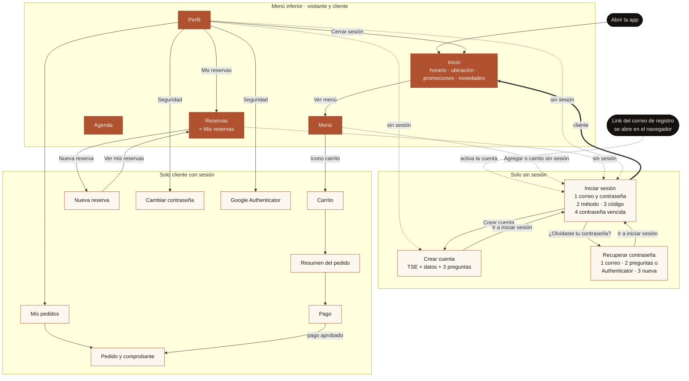

# AL FORNO · App móvil

Proyecto universitario: app móvil para la pizzería AL FORNO, conectada con
socios comerciales y servicios externos.
Historias de usuario vigentes: versión 2.7 + HU-25 a HU-30 (`Doc/`, fuera de git).
Base de datos: versión 2.5.

## Estructura

```
al_forno/
 ├─ app/          App móvil (React Native + Expo). Solo habla con la API de Node.
 │   └─ src/
 │       ├─ app/          Pantallas (cada archivo es una pantalla; Expo Router)
 │       ├─ components/   Piezas reutilizables (botones, campos, avisos, secciones)
 │       ├─ context/      Datos compartidos entre pantallas: sesión y carrito
 │       ├─ services/     Llamadas a la API (api.js es el único que usa fetch)
 │       ├─ utils/        Funciones de apoyo (colones, dólares, carrito, contraseñas)
 │       └─ config/       Dirección de la API y colores
 ├─ api/          API principal (Node.js + Express). Único acceso de la app a los datos.
 │   └─ src/
 │       ├─ modulos/      Un módulo por carpeta, con sus 3 capas:
 │       │    └─ menu/      menu.rutas.js → menu.servicio.js → menu.repositorio.js → MySQL
 │       ├─ config/       Conexión a MySQL (db.js), datos fijos del restaurante
 │       │                (restaurante.js) y reglas de seguridad (seguridad.js)
 │       ├─ middlewares/  Sesión y roles (autenticacion.js), validación (validar.js,
 │       │                reglasCuenta.js) y manejo central de errores (errores.js)
 │       └─ utils/        Hora de Costa Rica, cifrado AES, correos, errorCon y los
 │                        clientes de los servicios: banco.js, tse.js, socios.js, paypal.js
 ├─ api-socios/   API de AL FORNO para socios (PHP): el Hotel Las Brumas reserva mesas
 ├─ socios/       Servicios aparte, cada uno con su propia base de datos
 │   ├─ banco/        Banco Simulado (C# .NET) · tarjeta y SINPE Móvil
 │   ├─ tse/          TSE Simulado (C# .NET) · nombre según la identificación
 │   ├─ cartelera/    Socio: Cartelera de eventos (Python + Flask) · Agenda
 │   ├─ cerveceria/   Socio: Cervecería artesanal (Python + Flask) · Novedades
 │   └─ facturacion/  Socio: Facturación electrónica (Python + Flask) · factura del pedido
 └─ database/     Scripts SQL de AL FORNO (tablas, procedimientos, datos iniciales)
```

## Arquitectura

```
                      ┌─→ Banco Simulado (C#, 5001)        tarjeta y SINPE Móvil
                      ├─→ TSE Simulado (C#, 5004)          nombre en el registro
App (Expo) ─→ API Node (3000) ─→ MySQL al_forno     (solo procedimientos almacenados)
                      ├─→ Cartelera (Python, 5002)         agenda
                      ├─→ Facturación (Python, 5003)       factura del pedido
                      ├─→ Cervecería (Python, 5005)        novedades en Inicio
                      ├─→ PayPal Sandbox                   pago con PayPal
                      └─→ BCCR                             tipo de cambio del dólar

Hotel Las Brumas (Postman) ─→ API de socios PHP (8000) ─→ MySQL al_forno (mismos procedimientos)
```

- **La app nunca toca una base de datos:** todo lo pide a la API de Node, y la API
  solo usa procedimientos almacenados (`CALL sp_...`).
- **Cada socio y servicio tiene su propia base** (`banco_simulado`, `tse_simulado`,
  `cartelera_simulada`, `cerveceria_simulada`, `facturacion_simulada`), aparte de `al_forno`.
- **Si un socio no responde, la app sigue funcionando:** la sección de Novedades no
  se muestra, la Agenda avisa que no se pudo cargar y la factura queda "pendiente".
- **Por dentro, la API de Node tiene 5 capas:**

```
1. App (pantalla) ─→ services/api.js ─[internet]─→ 2. API (<modulo>.rutas.js)
   ─→ 3. Lógica de negocio (<modulo>.servicio.js) ─→ 4. Acceso a datos (<modulo>.repositorio.js)
   ─→ 5. MySQL (procedimiento almacenado: CALL sp_...)
```

Para ver cómo funciona un módulo, basta abrir su carpeta en `api/src/modulos/`.
Los módulos `recuperacion` y `perfil` usan `auth/auth.repositorio.js`; `agenda` y
`tipo-cambio` no tienen repositorio porque no usan la base de AL FORNO.

## Socios comerciales y servicios

| Servicio | Lenguaje · puerto | Su base | Métodos | Lo usa |
|---|---|---|---|---|
| Banco Simulado | C# .NET · 5001 | `banco_simulado` | `POST /pagos/tarjeta`, `POST /pagos/sinpe` | Pago (HU-08) |
| TSE Simulado | C# .NET · 5004 | `tse_simulado` | `GET /personas/{cedula\|dimex\|pasaporte}/{numero}` | Crear cuenta (HU-01) |
| **Socio** Cartelera de eventos | Python · 5002 | `cartelera_simulada` | `GET /eventos` | Agenda (HU-12) |
| **Socio** Facturación electrónica | Python · 5003 | `facturacion_simulada` | `POST /facturas`, `GET /facturas/<pedido_id>` | Comprobante y correo (HU-29) |
| **Socio** Cervecería artesanal | Python · 5005 | `cerveceria_simulada` | `GET /disponibles` | Novedades en Inicio (HU-28) |
| PayPal Sandbox | externo | — | órdenes de pago | Pago con PayPal (HU-26) |
| BCCR | externo | — | tipo de cambio (indicadores 317 y 318) | Total en dólares en Carrito y Resumen (HU-27) |

**Datos de prueba del Banco:** Visa `4111111111111111` 12/28 123 (aprobada) ·
MasterCard `5555555555554444` 06/29 456 (aprobada) · Amex `378282246310005` 03/28 1234
(sin saldo) · Visa `4000000000000002` 01/25 321 (vencida) · SINPE `88881111` y
`88882222` (aprobados), `88883333` (sin saldo).

**Datos de prueba del TSE:** cédula `112340567` (María Fernanda Rodríguez Mora) ·
`207650432` (Carlos Andrés Jiménez Solís) · DIMEX `155812345678` (Ana Lucía Pérez González) ·
`18620123456` (Luis Alberto Castillo Ruiz) · pasaporte `A1234567` (John Michael Smith).

## API de socios (PHP) · Hotel Las Brumas (HU-30)

Aquí AL FORNO es el socio comercial: el **Hotel Las Brumas** reserva mesas para sus
huéspedes con esta API. Está en `api-socios/` y usa los mismos procedimientos de
`al_forno` que la app, así que las reservas del hotel ocupan espacio en la app y al revés.

| Método | Ruta | Procedimiento | Respuesta |
|---|---|---|---|
| GET | `/disponibilidad?fecha=AAAA-MM-DD` | `sp_ListarOcupacion` | Las 4 horas del día con sus espacios libres |
| POST | `/reservas` con `{ fecha, hora, personas }` | `sp_CrearReserva` | 201 con la reserva · 409 si la hora está llena |
| GET | `/reservas/{id}` | `sp_ObtenerReserva` | La reserva · 404 si no es del hotel |
| DELETE | `/reservas/{id}` | `sp_CancelarReserva` | `{ id, estado: "Cancelada" }` · 404 si no existe |

- Cada petición lleva el encabezado `X-Llave-Socio` (la llave está en `api-socios/.env`);
  sin llave responde **401**.
- El hotel es un usuario con rol `SOCIO` (no puede entrar a la app). Su id se busca con
  su correo (`HOTEL_CORREO`). Solo ve y cancela sus propias reservas.
- Mismas reglas que la app; el hotel puede hacer varias reservas el mismo día.
- `index.php` recibe todas las peticiones (rutas y llave), `reservas.php` tiene los
  4 métodos y `conexion.php` la conexión PDO (consultas preparadas).
- Prueba: importar `api-socios/Al_Forno_API_Socios.postman_collection.json` en Postman.

## Reglas de reservas (HU-10, HU-11, HU-30)

- **Días:** hoy, mañana o pasado mañana.
- **Horas:** 6:00, 7:00, 8:00 y 9:00 p.m. Si es hoy, solo las que no han pasado.
- **Personas:** de 1 a 8. **Máximo 2 reservas por hora.**
- **Clientes:** 1 reserva confirmada por día. El hotel (socio) puede hacer varias.
- Los números están en `api/src/modulos/reservas/reservas.servicio.js` y
  `api-socios/reservas.php` (mismos valores). El máximo se le pasa a `sp_CrearReserva`,
  que usa un candado (`GET_LOCK`) para que dos reservas al mismo tiempo no pasen del máximo.

## Seguridad de la cuenta (solo clientes)

| Qué | Cómo | Historia |
|---|---|---|
| Registro | Identificación (el nombre lo da el TSE) + datos + ubicación + 3 preguntas de seguridad. La cuenta queda `PENDIENTE` hasta abrir el link del correo (vence en 24 h, un solo uso) | HU-01 |
| Inicio de sesión | Correo y contraseña → código de 6 dígitos por correo (vence en 2 min) o de Google Authenticator | HU-02, HU-21 |
| Bloqueo | 3 intentos fallidos seguidos → bloqueada 1 minuto (cuentan contraseña, códigos y respuestas) | HU-02 |
| Política de contraseñas | 8 caracteres o más con mayúscula, minúscula, número y símbolo; vence a los 90 días; no se repiten las últimas 5. La app muestra la lista con ✓ y la API la vuelve a revisar | HU-20 |
| Recuperar contraseña | Correo → 3 preguntas o código de Google Authenticator → contraseña nueva. Se avisa por correo | HU-22 |
| Google Authenticator | Opcional, desde el Perfil. Se vincula copiando la clave (sin QR) y confirmando el primer código | HU-21 |
| Datos sensibles | Contraseñas y respuestas con bcrypt; identificación, teléfono y clave de Authenticator cifrados con AES-256-GCM; códigos con hash SHA-256; la sesión de la app solo vive en memoria | HU-23 |
| Auditoría | Tabla `auditoria`: registro, logins exitosos y fallidos, bloqueos, cambios y recuperaciones de contraseña. Se consulta en la base (ver "Consultar la bitácora") | HU-24 |

Entre un paso y otro del login y de la recuperación, la API entrega un **pase**:
un token temporal (10 minutos) que solo sirve para el paso siguiente.

## Base de datos `al_forno` (versión 2.5 · 15 tablas, 30 procedimientos)

| Tabla | Para qué |
|---|---|
| `pais`, `provincia`, `canton`, `distrito` | Ubicación del cliente en el registro, en cascada (HU-01) |
| `usuario` | Clientes y el socio Hotel Las Brumas (rol `CLIENTE` o `SOCIO`): identificación y teléfono cifrados, `cedula_hash` para no repetirla, contraseña bcrypt, estado, intentos y bloqueo, Google Authenticator, distrito |
| `producto` | Menú (HU-03) |
| `promocion` | Promociones informativas (HU-06) |
| `pedido`, `pedido_detalle` | Pedidos pagados (forma de pago, detalle y referencia del cobro) y sus productos (HU-07 a HU-09) |
| `reserva` | Reservas de clientes y del hotel: fecha, hora, personas, estado (HU-10, HU-11, HU-30) |
| `pregunta_seguridad` | Las 5 preguntas para elegir (HU-01) |
| `usuario_respuesta` | Las 3 respuestas de cada cliente, con bcrypt (HU-01, HU-22) |
| `contrasena_historial` | Las últimas contraseñas, para no repetirlas (HU-20) |
| `token` | Link de verificación y código del doble factor: hash, vence, un solo uso (HU-01, HU-21) |
| `auditoria` | Actividad de seguridad, con fecha y hora de Costa Rica (HU-24) |

El horario y los datos del restaurante no están en la base: son fijos en
`api/src/config/restaurante.js`. La agenda viene del socio Cartelera de eventos.

**Instalación nueva:** correr en orden `01_tablas.sql`, `02_procedimientos.sql` y
`03_datos_iniciales.sql` (el 01 **borra** la base y la vuelve a crear).
**Base que ya tiene datos (versión 2.4):** correr solo `actualizar_a_2_5.sql`; no borra nada.

## Cómo se conecta cada pantalla

| Pantalla (`app/src/app/`) | Servicio de la app | Endpoint | Módulo | Procedimiento / origen |
|---|---|---|---|---|
| Inicio · Horario — `(tabs)/index.js` | `obtenerHorario()` | `GET /api/horario` | informacion | Fijo en `config/restaurante.js` |
| Inicio · Ubicación — `(tabs)/index.js` | `obtenerRestaurante()` | `GET /api/restaurante` | informacion | Fijo en `config/restaurante.js` |
| Inicio · Promociones — `(tabs)/index.js` | `listarPromociones()` | `GET /api/promociones` | informacion | `sp_ListarPromocionesActivas` |
| Inicio · Novedades — `(tabs)/index.js` | `listarNovedades()` | `GET /api/novedades` | informacion | Socio Cervecería (`GET /disponibles`) |
| Menú — `(tabs)/menu.js` | `obtenerMenu()` | `GET /api/menu` | menu | `sp_ListarMenu` |
| Agenda — `(tabs)/agenda.js` | `listarAgenda()` | `GET /api/agenda` | agenda | Socio Cartelera (`GET /eventos`) |
| Carrito y Resumen — `carrito.js`, `resumen-pedido.js` | `obtenerTipoCambio()` | `GET /api/tipo-cambio` | tipo-cambio | Carrito en la app (`context/CarritoContext.js`); dólares con el BCCR |
| Pago con tarjeta o SINPE — `pago.js` | `crearPedido()` | `POST /api/pedidos` | pedidos | Banco Simulado → `sp_CrearPedido` → socio Facturación |
| Pago con PayPal — `pago.js` | `iniciarPagoPaypal()`, `confirmarPagoPaypal()` | `POST /api/pedidos/paypal`, `/paypal/confirmar` | pedidos | PayPal Sandbox + BCCR → `sp_CrearPedido` → socio Facturación |
| Mis pedidos — `mis-pedidos/index.js` | `listarMisPedidos()` | `GET /api/pedidos` | pedidos | `sp_ListarPedidosCliente` |
| Pedido y comprobante — `mis-pedidos/[id].js` | `obtenerPedido()` | `GET /api/pedidos/:id` | pedidos | `sp_ObtenerPedido` + factura del socio Facturación (el estado lo calcula la API) |
| Nueva reserva — `nueva-reserva.js` | `listarHoras()`, `crearReserva()` | `GET /api/reservas/horas`, `POST /api/reservas` | reservas | `sp_ListarOcupacion`, `sp_CrearReserva` |
| Mis reservas — `(tabs)/reservas.js` | `listarMisReservas()`, `cancelarReserva()` | `GET /api/reservas`, `PATCH /api/reservas/:id/cancelar` | reservas | `sp_ListarReservasCliente`, `sp_CancelarReserva` |
| Crear cuenta — `registro.js` | `consultarIdentificacion()`, `obtenerPreguntas()`, `registrar()`, `reenviarVerificacion()` | `GET /api/auth/identificacion`, `GET /api/auth/preguntas`, `POST /api/auth/registro`, `POST /api/auth/reenviar-verificacion` | auth | TSE Simulado, `sp_ListarPreguntas`, `sp_RegistrarUsuario`, `sp_GuardarToken`, `sp_ObtenerUsuarioPorCorreo`, `sp_RegistrarAuditoria` |
| Crear cuenta · ubicación — `registro.js` | `listarPaises()`… | `GET /api/ubicacion/paises`, `/provincias`, `/cantones`, `/distritos` | ubicacion | `sp_ListarPaises`, `sp_ListarProvincias`, `sp_ListarCantones`, `sp_ListarDistritos` |
| Link del correo (navegador) | — | `GET /api/auth/verificar?token=` | auth | `sp_UsarToken`, `sp_ActivarUsuario` |
| Iniciar sesión — `login.js` | `login()`, `enviarCodigo()`, `verificarCodigo()`, `cambiarContrasenaVencida()` | `POST /api/auth/login`, `/login/enviar-codigo`, `/login/verificar`, `/login/cambiar-contrasena` | auth | `sp_ObtenerUsuarioPorCorreo`, `sp_ActualizarIntentos`, `sp_GuardarToken`, `sp_UsarToken`, `sp_ObtenerAuthenticator`, `sp_CambiarContrasena`, `sp_ListarHistorialContrasenas`, `sp_RegistrarAuditoria` |
| Recuperar contraseña — `recuperar.js` | `iniciarRecuperacion()`, `verificarIdentidad()`, `guardarNuevaContrasena()` | `POST /api/recuperacion/inicio`, `/verificar`, `/nueva` | recuperacion | `sp_ObtenerUsuarioPorCorreo`, `sp_ObtenerPreguntasUsuario`, `sp_ObtenerAuthenticator`, `sp_ActualizarIntentos`, `sp_CambiarContrasena`, `sp_ListarHistorialContrasenas`, `sp_RegistrarAuditoria` |
| Perfil — `(tabs)/perfil.js` | `obtenerPerfil()` | `GET /api/perfil` | perfil | `sp_ObtenerUsuario` |
| Cambiar contraseña — `cambiar-contrasena.js` | `cambiarContrasena()` | `PUT /api/perfil/contrasena` | perfil | `sp_ObtenerUsuarioPorCorreo`, `sp_CambiarContrasena`, `sp_ListarHistorialContrasenas`, `sp_RegistrarAuditoria` |
| Google Authenticator — `autenticador.js` | `iniciarVinculacion()`, `confirmarVinculacion()`, `desvincularAutenticador()` | `POST /api/perfil/autenticador`, `POST /api/perfil/autenticador/confirmar`, `DELETE /api/perfil/autenticador` | perfil | `sp_GuardarAuthenticator`, `sp_ObtenerAuthenticator`, `sp_ActivarAuthenticator`, `sp_DesvincularAuthenticator` |
| (Prueba de conexión) | — | `GET /api/salud` | salud | `SELECT 1` |

Las rutas `/api/auth` y `/api/recuperacion` aceptan como máximo 50 envíos (POST)
cada 15 minutos por dirección IP.

## Cómo correr el proyecto

Requisitos: MySQL 8, Node.js, .NET 10 SDK, Python 3, PHP 8 (con `pdo_mysql`), Android
Studio (emulador) y Postman. Cada servicio corre en su propia ventana de terminal.

1. **Bases de datos** (MySQL Workbench):
   - AL FORNO: `database/01_tablas.sql`, `02_procedimientos.sql`, `03_datos_iniciales.sql`.
   - Cada servicio: `socios/banco/banco.sql`, `socios/tse/tse.sql`,
     `socios/cartelera/cartelera.sql`, `socios/cerveceria/cerveceria.sql`,
     `socios/facturacion/facturacion.sql`.
2. **Archivos `.env`:** en `api/`, `api-socios/` y cada carpeta de `socios/`, copiar
   `.env.example` como `.env` y poner la contraseña de MySQL. Los `.env` nunca se suben a git.
3. **Banco y TSE (C#):** en `socios/banco/` y en `socios/tse/`:
   ```
   dotnet run
   ```
4. **Socios (Python):** en `socios/cartelera/`, `socios/cerveceria/` y `socios/facturacion/`:
   ```
   pip install -r requirements.txt     (solo la primera vez)
   python app.py
   ```
5. **API de socios (PHP):** doble clic en `api-socios/iniciar.bat`
   (o `php -S localhost:8000 index.php` dentro de `api-socios/`).
   Si avisa que falta `pdo_mysql`, quitar el `;` de `;extension=pdo_mysql` en el `php.ini`
   (`php --ini` dice dónde está).
6. **API principal (Node):**
   ```
   cd api
   npm install
   npm run dev
   ```
   En `api/.env` van, además de MySQL (ver los comentarios de `.env.example`):
   - `CLAVE_CIFRADO` y `CLAVE_HASH_CEDULA`: se generan una sola vez con
     `node -e "console.log(require('crypto').randomBytes(32).toString('hex'))"`.
     Si se cambia `CLAVE_CIFRADO`, ya no se pueden leer las identificaciones ni los teléfonos guardados.
   - `CORREO_USUARIO` y `CORREO_CONTRASENA`: cuenta de Gmail con contraseña de aplicación.
     **Si `CORREO_CONTRASENA` queda vacía, la API está en modo prueba:** no envía
     correos y muestra el link de verificación y los códigos en su terminal.
   - `URL_PUBLICA`: dirección que va en el link del correo. Con `http://localhost:3000`
     el link se abre en el navegador de la computadora; para abrirlo en el celular,
     poner la IP de la computadora (ej. `http://192.168.1.25:3000`).
   - `BANCO_URL`, `TSE_URL`, `CARTELERA_URL`, `FACTURACION_URL`, `CERVECERIA_URL`:
     dirección de cada servicio (ej. `http://localhost:5001`).
   - `BCCR_TOKEN` (tipo de cambio) y `PAYPAL_URL`, `PAYPAL_CLIENT_ID`, `PAYPAL_SECRET`
     (PayPal Sandbox).

   Probar en el navegador: http://localhost:3000/api/salud
7. **App:**
   ```
   cd app
   npm install
   npm run emulador
   ```
   Presionar `a` para abrirla en el emulador de Android. `npm run emulador` arranca
   Expo con la dirección `10.0.2.2`, que es como el emulador llama a la computadora
   (con `npx expo start` normal a veces sale `Failed to download remote update`).
   En un celular real se usa `npx expo start` y se escanea el QR con Expo Go
   (celular y computadora en la misma Wi-Fi; no usar `--tunnel`).

   Si Expo Go dice que el proyecto es incompatible ("SDK 58"), Expo Go se
   actualizó solo. Desinstalarlo del emulador y presionar `a` otra vez: Expo
   instala la versión que corresponde al proyecto (SDK 57). En PowerShell:
   ```
   & "$env:LOCALAPPDATA\Android\Sdk\platform-tools\adb.exe" uninstall host.exp.exponent
   ```

   Para instalar librerías nuevas en la app usar `npx expo install <librería>`
   (no `npm install`). Si un cambio no se ve (sobre todo en `_layout.js` o en los
   contextos), reiniciar con `npx expo start --clear`.

8. **Google Authenticator:** se instala desde la tienda de apps (también dentro del
   emulador). En Perfil → Google Authenticator → Generar clave → Copiar; en Google
   Authenticator tocar "+" → "Ingresar una clave de configuración", pegar la
   clave (basada en el tiempo) y escribir en AL FORNO el código que aparece.

## Antes de la defensa

1. **Red:** el BCCR, PayPal y el correo necesitan internet. Si la red de la U bloquea
   algo, usar el **hotspot del celular**.
2. **IP de la computadora:** `ipconfig` → "Dirección IPv4". Ponerla en `api/.env`:
   `URL_PUBLICA=http://<IP>:3000` y **reiniciar la API** (`--watch` no vuelve a leer el `.env`).
3. **Encender todo:** MySQL, Banco, TSE, Cartelera, Cervecería, Facturación, API de socios,
   API principal y la app. Probar http://localhost:3000/api/salud.
4. **AVG:** la carpeta del proyecto debe estar en Excepciones (Archivo/Carpeta); si no,
   AVG puede quitar `iniciar.bat`. En Escudo de correo, "Analizar correos salientes
   (SMTP)" debe estar **desmarcado** (si no, falla el correo con `SELF_SIGNED_CERT_IN_CHAIN`).
   Para revisarlo, en `api/` (debe decir *Google Trust Services*):
   ```
   node -e "const t=require('tls').connect(465,'smtp.gmail.com',{rejectUnauthorized:false},()=>{let c=t.getPeerCertificate(true);while(c){console.log(c.issuer.O||c.issuer.CN);if(c.issuerCertificate===c)break;c=c.issuerCertificate}t.end()})"
   ```
5. **Reservas limpias:** cancelar las reservas de prueba del hotel:
   ```sql
   UPDATE al_forno.reserva r JOIN al_forno.usuario u ON u.id = r.usuario_id
      SET r.estado = 'Cancelada' WHERE u.rol = 'SOCIO';
   ```
   En Postman, borrar el valor de la variable `fecha` de la colección (se llena sola con mañana).
6. **Prueba de correo:** crear una cuenta y revisar que llegan el link de verificación
   y el código de 6 dígitos. Para varias cuentas con un mismo Gmail se usa un alias
   (`tucorreo+prueba1@gmail.com`, `+prueba2`…) y una identificación distinta en cada una.

Si no hay celular a mano para Google Authenticator, el código se genera en `api/` con
`node -e "console.log(require('otplib').generateSync({ secret: 'CLAVE' }))"`.

## Consultar la bitácora (tabla `auditoria`, HU-24)

En MySQL Workbench (primero `USE al_forno;` o doble clic en el schema):

```sql
-- Últimas 50 actividades
SELECT id, fecha, hora, correo, actividad, resultado, ip, dispositivo
FROM auditoria ORDER BY id DESC LIMIT 50;

-- Solo lo de hoy
SELECT fecha, hora, correo, actividad, resultado
FROM auditoria WHERE fecha = CURRENT_DATE ORDER BY hora DESC;

-- Intentos fallidos y bloqueos
SELECT fecha, hora, correo, actividad, ip
FROM auditoria WHERE actividad IN ('LOGIN_FALLIDO', 'BLOQUEO') ORDER BY id DESC;

-- Todo lo de un cliente
SELECT fecha, hora, actividad, resultado, ip
FROM auditoria WHERE correo = 'cliente@correo.com' ORDER BY id DESC;

-- Resumen: cuántas veces pasó cada actividad
SELECT actividad, resultado, COUNT(*) AS veces
FROM auditoria GROUP BY actividad, resultado ORDER BY actividad, resultado;
```

Actividades posibles: `REGISTRO`, `LOGIN_EXITOSO`, `LOGIN_FALLIDO`, `BLOQUEO`,
`CAMBIO_CONTRASENA`, `RECUPERACION`; resultado: `EXITO` o `FALLO`. `usuario_id` queda
en `NULL` cuando se escribió un correo que no existe.

## Mapa de navegación

GitHub dibuja estos diagramas. La imagen está en `Doc/` (fuera de git): `Mapa_navegacion_cliente.png`.

Colores: **terracota** = pestañas del menú inferior; **crema** = pantallas que se abren
encima; **negro** = entradas y salidas. Línea punteada = pasa solo si no hay sesión;
línea gruesa = a dónde lleva la app sola después de iniciar sesión.

### Visitante y cliente



Notas del mapa:

- **Quién ve qué** lo decide `app/src/app/_layout.js` con `Stack.Protected`: el visitante
  y el cliente ven el menú inferior; Iniciar sesión, Crear cuenta y Recuperar solo
  aparecen sin sesión; carrito, pago, pedidos, nueva reserva y Seguridad piden sesión de
  cliente.
- **Nadie navega "a mano" después del login ni al cerrar sesión:** al cambiar la sesión,
  Expo Router lleva a la primera pantalla permitida (Inicio).
- **Botones que piden sesión** (Agregar en el Menú, ícono del carrito): sin sesión abren
  Iniciar sesión (`components/Boton.js`, `BotonCarrito.js`, `TarjetaProducto.js`).
- **Pago aprobado:** cierra Carrito, Resumen y Pago (`dismissAll`) y abre el comprobante;
  la flecha "atrás" ya no vuelve al pago.
- **Iniciar sesión y Recuperar contraseña** son una sola pantalla cada una, con pasos.
- **Perfil y Reservas** tienen dos versiones: sin sesión invitan a iniciar sesión o
  crear cuenta; con sesión muestran los datos del cliente.
- La seguridad real no está en la navegación: la API revisa el token y el rol en cada petición.

## Navegación de la app (Expo Router)

Cada archivo dentro de `app/src/app/` es una pantalla y su ruta sale de la carpeta.
Las carpetas entre paréntesis, como `(tabs)`, agrupan pantallas sin aparecer en la
ruta; `[id]` es una parte variable (ej. `/mis-pedidos/15`); `_layout.js` define
cómo se navega dentro de esa carpeta.

```
app/src/app/
 ├─ _layout.js     Navegación principal y protección (visitante o cliente)
 ├─ (tabs)/        Menú inferior del cliente: Inicio · Menú · Agenda · Reservas · Perfil
 ├─ login.js, registro.js, recuperar.js                     (solo sin sesión)
 ├─ carrito.js, resumen-pedido.js, pago.js                  (requieren sesión de cliente)
 ├─ mis-pedidos/ (lista y [id]: estado y comprobante)
 ├─ nueva-reserva.js
 └─ cambiar-contrasena.js, autenticador.js                  (Perfil → Seguridad)
```

La sesión vive solo en memoria (`context/SesionContext.js`): al cerrar la app
hay que iniciar sesión de nuevo (HU-02, HU-23).
